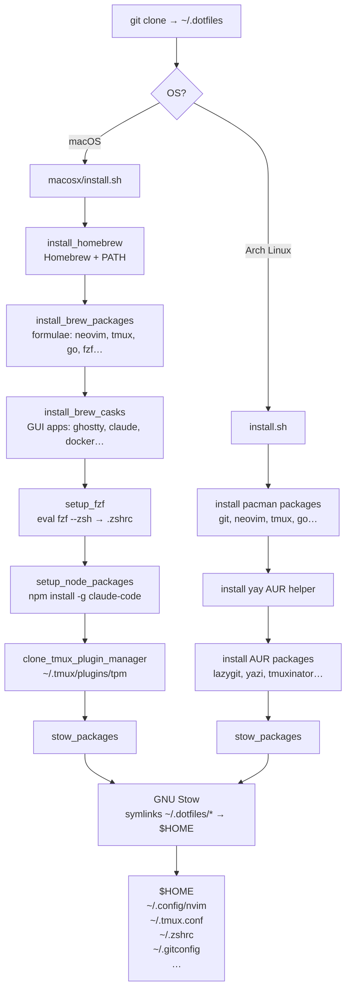

# dotfiles

Personal dotfiles managed with [GNU Stow](https://www.gnu.org/software/stow/).

## How it works



## Structure

```
.dotfiles/
├── arch/          # Arch Linux install script
├── macosx/        # macOS install script
├── gitconfig/     # Git configuration
├── gnupg/         # GPG configuration
├── nvim/          # Neovim configuration
├── tmux/          # Tmux configuration
├── zshrc/         # Zsh configuration
├── zprofile/      # Zsh profile
├── wezterm/       # WezTerm configuration
├── ghostty/       # Ghostty configuration
├── hammerspoon/   # Hammerspoon keybindings (run-or-raise)
└── stow.sh        # Stow all packages at once
```

## Fresh Mac bootstrap

On a brand new Mac you can't `git clone` before installing the CLT. Use `curl` instead — it's always available:

```bash
bash -c "$(curl -fsSL https://raw.githubusercontent.com/danyelaristizabal/.dotfiles/refs/heads/master/macosx/install.sh)"

```

The script will install Xcode Command Line Tools, clone this repo, and set everything up automatically.

## Setup (macOS)

1. Clone the repository:

   ```bash
   git clone git@github.com:danyelaristizabal/.dotfiles.git ~/.dotfiles
   ```

2. Enter the directory:

   ```bash
   cd ~/.dotfiles
   ```

3. Run the install script (installs Homebrew, packages, casks, and stows dotfiles):

   ```bash
   ./macosx/install.sh
   ```

4. Restart your terminal or reload the shell:

   ```bash
   source ~/.zshrc
   ```

## Setup (Arch Linux)

1. Clone the repository:

   ```bash
   git clone git@github.com:danyelaristizabal/.dotfiles.git ~/.dotfiles
   ```

2. Enter the directory:

   ```bash
   cd ~/.dotfiles
   ```

3. Run the install script:

   ```bash
   ./install.sh
   ```

4. Restart your terminal or reload the shell:

   ```bash
   source ~/.zshrc
   ```

## Post-install manual steps

### Mission Control (required for Hammerspoon Space-switching)

Enable "When switching to an application, switch to a Space with open windows" in System Settings → Desktop & Dock → Mission Control, or run:

```bash
defaults write com.apple.dock workspaces-auto-swoosh -bool YES && killall Dock
```

### Hammerspoon

1. **Grant Accessibility permission** — on first launch, macOS will prompt you; approve it in System Settings → Privacy & Security → Accessibility
2. **Remove conflicting Raycast hotkeys** — any binding that collides (⌥C, ⌥V, ⌥S, ⌥B, ⌥↩, ⌥⇧C, ⌥/) will be swallowed by Raycast before Hammerspoon sees it
3. **Press ⌥/** to show a cheatsheet of all configured bindings on screen

## Stow only

To symlink dotfiles without reinstalling packages:

```bash
cd ~/.dotfiles
./stow.sh
```
